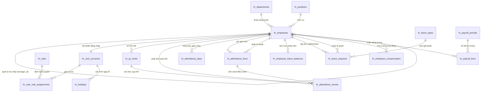

# HR Management with AI System (Group 3 HRMS)

Hệ thống quản lý nhân sự, chấm công Kiosk qua thẻ QR tĩnh, quản lý nghỉ phép & làm việc từ xa (Remote), tính lương tự động theo luật Việt Nam và Trợ lý AI nội bộ của Group 3.

> 📖 **Tài liệu tham khảo liên quan:**
> * 🏛️ **Kiến trúc phần mềm tổng thể:** [docs/ARCHITECTURE.md](docs/ARCHITECTURE.md)
> * 🚀 **Hướng dẫn cài đặt & vận hành:** [docs/SETUP_GUIDE.md](docs/SETUP_GUIDE.md)

---

## 1. Mô tả Nghiệp vụ cốt lõi (Business Domain)

Hệ thống được thiết kế áp dụng cho mô hình doanh nghiệp chuẩn với **một văn phòng/chi nhánh làm việc duy nhất**, giờ hành chính cố định, không chia ca kíp phức tạp.

### 1.1. Lịch làm việc & Ngày công chuẩn
* **Giờ làm việc hành chính:** Cố định từ **08:00 đến 17:00**, từ Thứ Hai đến Thứ Sáu hàng tuần (không làm việc Thứ Bảy và Chủ Nhật).
* **Thời gian nghỉ trưa:** Cố định từ **12:00 đến 13:00** (1 tiếng) – thời gian này **không được tính vào số giờ làm việc thực tế**.
* **Ngày công chuẩn:** 8 tiếng làm việc thực tế trong khung giờ quy định tương đương **1.0 ngày công**.

### 1.2. Chấm công Kiosk QR & Giải trình ngày công
* **Thẻ QR tĩnh:** Mỗi nhân viên được cấp một thẻ QR vật lý tĩnh mang mã định danh an toàn, không thay đổi theo thời gian.
* **Màn hình Kiosk:** Thiết bị đặt tại cửa văn phòng, camera tự động nhận diện thẻ QR để ghi nhận lượt vào đầu tiên (`CHECK_IN`) và lượt ra cuối cùng (`CHECK_OUT`).
* **Giải trình quên chấm công:** 
  * Nhân viên phát hiện thiếu lượt vào/ra có quyền nộp đơn **Giải trình chấm công** trên hệ thống (chọn ngày, loại lượt bổ sung, giờ thực tế và lý do).
  * **Hạn chốt giải trình:** Đơn phải được gửi và được Quản lý duyệt **trước ngày chốt công cuối tháng**. Mọi trường hợp thiếu lượt quét không có giải trình được duyệt trước hạn chốt sẽ bị mất công và không tính lương ngày đó.
* **Lịch sử & Đối chiếu:** Mọi đơn giải trình sau khi Quản lý duyệt hoặc từ chối đều **được lưu vết đầy đủ trong hệ thống** (kèm tên người duyệt, thời gian duyệt, ghi chú phản hồi) và hiển thị trực tiếp trên Bảng công để Quản lý và Nhân viên đối chiếu minh bạch khi có khiếu nại.

### 1.3. Nghỉ phép & Làm việc từ xa (Remote)
* **Hình thức đăng ký:**
  * **Buổi sáng (`MORNING`):** 08:00 - 12:00 (tính 0.5 ngày công).
  * **Buổi chiều (`AFTERNOON`):** 13:00 - 17:00 (tính 0.5 ngày công).
  * **Cả ngày (`FULL_DAY`):** 08:00 - 17:00 (tính 1.0 ngày công).
* **Loại đơn:**
  * **Phép năm (`ANNUAL`):** Hưởng 100% lương, trừ vào hạn mức phép năm.
  * **Làm việc từ xa (`REMOTE`):** Hưởng 100% lương, **không trừ vào hạn mức phép năm**.
  * **Nghỉ không lương (`UNPAID`):** Không tính lương ngày nghỉ.
  * **Nghỉ ốm (`SICK`):** Theo chế độ quy định.
* **Hạn mức & Hết hạn phép năm:**
  * Tiêu chuẩn 12 ngày phép năm/năm cho mỗi nhân viên.
  * Toàn bộ số ngày phép năm chưa sử dụng **tự động hết hạn vào ngày 31/12 hàng năm**, không bảo lưu hay cộng dồn sang năm sau.
  * Khi nhân viên dùng hết số dư phép năm, các đơn xin nghỉ phép tiếp theo bắt buộc phải chuyển sang loại Nghỉ không hưởng lương.
* **Lịch sử phê duyệt:** Đơn sau khi duyệt hoặc từ chối được lưu trữ vĩnh viễn trong danh sách lịch sử phục vụ tra cứu.

### 1.4. Quy định ngày nghỉ lễ (Holidays)
* Danh mục ngày lễ trong năm được thiết lập bởi vai trò **ADMIN** hoặc **HR**.
* Nhân viên được **tính đủ ngày công hưởng nguyên lương** vào các ngày lễ mà không cần phải thực hiện chấm công.
* Không cho phép chỉnh sửa hoặc xóa ngày nghỉ lễ nếu ngày đó đã diễn ra trong quá khứ (`holiday_date < CURRENT_DATE`).

### 1.5. Cơ chế Phê duyệt phân cấp
* **Quản lý trực tiếp (`manager_employee_id`)** là người duy nhất có thẩm quyền xem xét và phê duyệt/từ chối:
  1. Đơn giải trình bổ sung chấm công của cấp dưới.
  2. Đơn xin nghỉ phép và đơn đăng ký làm việc từ xa (Remote) của cấp dưới.
* Quy trình phê duyệt diễn ra độc lập, trực tiếp giữa Quản lý và Nhân viên, không bắt buộc qua bước duyệt trung gian của HR.

### 1.6. Kỳ tính lương, Thuế TNCN & Báo cáo
* **Kỳ tính lương:** Tính tròn theo tháng dương lịch, từ ngày 01 đến ngày cuối cùng của tháng.
* **Mức lương căn bản:** Tính theo mức **lương GROSS** ghi trên hợp đồng lao động do HR quản lý.
* **Ngày công chuẩn trong tháng:** Tổng các ngày trong tháng trừ Thứ Bảy, Chủ Nhật; bao gồm các ngày Lễ hưởng nguyên lương.
* **Trích đóng bảo hiểm bắt buộc (Luật Lao động Việt Nam):** Tính trên mức lương đóng bảo hiểm:
  * BHXH: **8%**
  * BHYT: **1.5%**
  * BHTN: **1%**
  *(Tổng tỷ lệ trích nộp người lao động: **10.5%**)*.
* **Thuế Thu nhập cá nhân (TNCN):** Tính sau khi giảm trừ bảo hiểm bắt buộc, áp dụng mức giảm trừ bản thân 11.000.000 VNĐ/tháng và biểu thuế lũy tiến từng phần theo luật Việt Nam.
* **Khóa kỳ lương (`CLOSED`):** Sau khi rà soát, HR tiến hành Khóa kỳ lương để cố định số liệu kế toán; chặn mọi điều chỉnh hồi tố về chấm công và nghỉ phép của tháng đó; đồng thời hỗ trợ xuất báo cáo bảng lương ra file Excel (`.xlsx`).

### 1.7. Trợ lý AI nội bộ (AI Assistant)
* Hỗ trợ hỏi đáp chính sách nhân sự (giờ giấc, quy chế nghỉ phép, chế độ thai sản/ốm đau, cách tính lương/thuế).
* Tra cứu dữ liệu cá nhân theo ngữ cảnh thực của nhân viên đang đăng nhập (số dư phép năm còn lại, số ngày công đã tích lũy trong tháng, cảnh báo ngày thiếu chấm công).
* Hỗ trợ tạo bản nháp đơn xin nghỉ phép và đơn giải trình công qua hội thoại.

---

## 2. Thiết kế Cơ sở dữ liệu (Database Design)

### 2.1. Sơ đồ quan hệ thực thể (ERD Diagram)



---

### 2.2. Danh mục 14 Bảng dữ liệu

| Phân vùng | Tên bảng | Mục đích lưu trữ nghiệp vụ |
| :--- | :--- | :--- |
| **Tổ chức & Nhân sự** | `hr_departments` | Danh mục phòng ban trong doanh nghiệp |
| | `hr_positions` | Danh mục chức vụ, vị trí công việc |
| | `hr_employees` | Hồ sơ nhân viên, thông tin Quản lý trực tiếp (`manager_employee_id`) |
| **Tài khoản & Quyền** | `hr_user_accounts` | Tài khoản đăng nhập, mật khẩu băm bcrypt |
| | `hr_roles` | Danh mục vai trò (`ADMIN`, `HR`, `MANAGER`, `EMPLOYEE`) |
| | `hr_user_role_assignments` | Phân quyền vai trò cho từng tài khoản |
| **Cấu hình Ngày lễ** | `hr_holidays` | Ngày lễ tết trong năm được tính đủ công hưởng lương |
| **Chấm công QR** | `hr_qr_cards` | Thẻ QR vật lý tĩnh chứa token hash SHA-256 |
| | `hr_attendance_events` | Nhật ký quẹt thẻ append-only và sự kiện điều chỉnh |
| | `hr_attendance_days` | Tổng hợp thời gian In/Out, số phút làm việc và trạng thái ngày công |
| | `hr_attendance_fixes` | Đơn giải trình quên quẹt thẻ, lưu vết người duyệt và lịch sử |
| **Nghỉ phép & Remote** | `hr_leave_types` | Danh mục loại nghỉ (`ANNUAL`, `REMOTE`, `UNPAID`, `SICK`) |
| | `hr_employee_leave_balances` | Hạn mức phép năm, số ngày đã nghỉ và số dư phép |
| | `hr_leave_requests` | Đơn xin nghỉ phép/remote, lưu vết người duyệt và lịch sử |
| **Lương & Thuế** | `hr_employee_compensation` | Lịch sử mức lương Gross và phụ cấp thỏa thuận |
| | `hr_payroll_periods` | Danh mục kỳ tính lương tháng và trạng thái khóa kỳ |
| | `hr_payroll_lines` | Chi tiết bảng lương nhân viên (ngày công, bảo hiểm, thuế TNCN, Net) |

---

### 2.3. Lược đồ DBML chi tiết

```dbml
Table hr_departments {
	department_id bigint [pk, increment]
	department_code varchar(30) [not null, unique]
	department_name varchar(150) [not null]
	manager_employee_id bigint
	is_active boolean [not null, default: true]
	created_at timestamp [not null, default: `now()`]
	updated_at timestamp [not null, default: `now()`]
}

Table hr_positions {
	position_id bigint [pk, increment]
	position_code varchar(30) [not null, unique]
	position_name varchar(150) [not null]
	is_active boolean [not null, default: true]
	created_at timestamp [not null, default: `now()`]
	updated_at timestamp [not null, default: `now()`]
}

Table hr_employees {
	employee_id bigint [pk, increment]
	employee_code varchar(30) [not null, unique]
	full_name varchar(200) [not null]
	email varchar(254) [not null, unique]
	phone_number varchar(20)
	date_of_birth date
	department_id bigint [not null]
	position_id bigint [not null]
	manager_employee_id bigint [note: 'Quản lý trực tiếp xét duyệt đơn']
	employment_status varchar(20) [not null, note: 'ACTIVE, INACTIVE, TERMINATED']
	hire_date date [not null]
	termination_date date
	created_at timestamp [not null, default: `now()`]
	updated_at timestamp [not null, default: `now()`]
}

Table hr_user_accounts {
	user_account_id bigint [pk, increment]
	employee_id bigint [not null, unique]
	login_email varchar(254) [not null, unique]
	password_hash varchar(255) [not null, note: 'Băm bằng bcrypt']
	is_active boolean [not null, default: true]
	last_login_at timestamp
	created_at timestamp [not null, default: `now()`]
}

Table hr_roles {
	role_id bigint [pk, increment]
	role_code varchar(30) [not null, unique, note: 'ADMIN, HR, MANAGER, EMPLOYEE']
	role_name varchar(100) [not null]
}

Table hr_user_role_assignments {
	user_role_assignment_id bigint [pk, increment]
	user_account_id bigint [not null]
	role_id bigint [not null]
	created_at timestamp [not null, default: `now()`]

	indexes {
		(user_account_id, role_id) [unique, name: 'uq_hr_user_roles_account_role']
	}
}

Table hr_holidays {
	holiday_id bigint [pk, increment]
	holiday_date date [not null, unique, note: 'Ngày lễ hưởng nguyên lương']
	holiday_name varchar(150) [not null]
	is_paid boolean [not null, default: true]
	created_by_user_id bigint [not null]
	created_at timestamp [not null, default: `now()`]
}

Table hr_qr_cards {
	qr_card_id bigint [pk, increment]
	employee_id bigint [not null]
	token_hash varchar(255) [not null, unique, note: 'Hash SHA-256 của token thẻ tĩnh']
	card_code varchar(255)
	issued_at timestamp [not null]
	expires_at timestamp
	revoked_at timestamp
	created_by_user_id bigint [not null]
}

Table hr_attendance_events {
	attendance_event_id bigint [pk, increment]
	employee_id bigint [not null]
	qr_card_id bigint
	event_type varchar(20) [not null, note: 'CHECK_IN, CHECK_OUT']
	source varchar(20) [not null, note: 'QR_SCAN, APPROVED_FIX']
	occurred_at timestamp [not null]
	device_id varchar(100)
	idempotency_key varchar(100) [not null, unique]
	attendance_fix_id bigint
	created_at timestamp [not null, default: `now()`]

	indexes {
		(employee_id, occurred_at) [name: 'idx_hr_att_events_employee_time']
	}
}

Table hr_attendance_days {
	attendance_day_id bigint [pk, increment]
	employee_id bigint [not null]
	work_date date [not null]
	first_check_in_at timestamp
	last_check_out_at timestamp
	worked_minutes integer [not null, default: 0]
	attendance_status varchar(20) [not null, note: 'PRESENT, INCOMPLETE, ABSENT, ON_LEAVE, HOLIDAY, REMOTE']
	updated_at timestamp [not null, default: `now()`]

	indexes {
		(employee_id, work_date) [unique, name: 'uq_hr_att_days_employee_date']
	}
}

Table hr_attendance_fixes {
	attendance_fix_id bigint [pk, increment]
	employee_id bigint [not null]
	work_date date [not null]
	event_type varchar(20) [not null, note: 'CHECK_IN, CHECK_OUT']
	requested_at timestamp [not null]
	reason text [not null]
	status varchar(20) [not null, default: 'PENDING', note: 'PENDING, APPROVED, REJECTED']
	reviewer_employee_id bigint [note: 'Quản lý trực tiếp duyệt']
	reviewed_at timestamp
	review_note text
	created_at timestamp [not null, default: `now()`]
}

Table hr_leave_types {
	leave_type_id bigint [pk, increment]
	leave_code varchar(30) [not null, unique, note: 'ANNUAL, REMOTE, UNPAID, SICK']
	leave_name varchar(100) [not null]
	is_paid boolean [not null, default: true]
	is_active boolean [not null, default: true]
}

Table hr_employee_leave_balances {
	leave_balance_id bigint [pk, increment]
	employee_id bigint [not null]
	year integer [not null]
	total_entitled_days decimal(5, 2) [not null, default: 12.0]
	used_days decimal(5, 2) [not null, default: 0]
	remaining_days decimal(5, 2) [not null, note: 'Hết hạn vào ngày 31/12']
	updated_at timestamp [not null, default: `now()`]

	indexes {
		(employee_id, year) [unique, name: 'uq_hr_leave_balance_emp_year']
	}
}

Table hr_leave_requests {
	leave_request_id bigint [pk, increment]
	employee_id bigint [not null]
	leave_type_id bigint [not null]
	leave_date date [not null]
	session varchar(20) [not null, note: 'MORNING, AFTERNOON, FULL_DAY']
	leave_days decimal(3, 1) [not null, note: '0.5 hoặc 1.0 ngày']
	reason text
	status varchar(20) [not null, default: 'PENDING', note: 'PENDING, APPROVED, REJECTED, CANCELLED']
	reviewer_employee_id bigint [note: 'Quản lý trực tiếp duyệt']
	reviewed_at timestamp
	review_note text
	created_at timestamp [not null, default: `now()`]
}

Table hr_employee_compensation {
	employee_compensation_id bigint [pk, increment]
	employee_id bigint [not null]
	base_monthly_salary decimal(18, 2) [not null, note: 'Lương Gross hợp đồng']
	fixed_allowance decimal(18, 2) [not null, default: 0]
	currency_code varchar(3) [not null, default: 'VND']
	effective_from date [not null]
	effective_to date
	created_by_user_id bigint [not null]
	created_at timestamp [not null, default: `now()`]
}

Table hr_payroll_periods {
	payroll_period_id bigint [pk, increment]
	period_year integer [not null]
	period_month integer [not null]
	start_date date [not null]
	end_date date [not null]
	status varchar(20) [not null, default: 'DRAFT', note: 'DRAFT, CALCULATED, APPROVED, CLOSED']
	created_by_user_id bigint [not null]
	approved_by_user_id bigint
	closed_at timestamp
	created_at timestamp [not null, default: `now()`]

	indexes {
		(period_year, period_month) [unique, name: 'uq_hr_pay_period_year_month']
	}
}

Table hr_payroll_lines {
	payroll_line_id bigint [pk, increment]
	payroll_period_id bigint [not null]
	employee_id bigint [not null]
	base_salary decimal(18, 2) [not null]
	currency_code varchar(3) [not null, default: 'VND']
	standard_work_days decimal(4, 1) [not null]
	actual_work_days decimal(4, 1) [not null]
	gross_salary decimal(18, 2) [not null]
	insurance_deduction decimal(18, 2) [not null, default: 0, note: '10.5% (BHXH 8%, BHYT 1.5%, BHTN 1%)']
	taxable_income decimal(18, 2) [not null, default: 0]
	personal_income_tax decimal(18, 2) [not null, default: 0, note: 'Biểu thuế lũy tiến từng phần']
	other_deductions decimal(18, 2) [not null, default: 0]
	net_salary decimal(18, 2) [not null]
	calculation_details json
	calculated_at timestamp [not null]

	indexes {
		(payroll_period_id, employee_id) [unique, name: 'uq_hr_pay_lines_period_employee']
	}
}

Ref: hr_departments.manager_employee_id > hr_employees.employee_id
Ref: hr_employees.department_id > hr_departments.department_id
Ref: hr_employees.position_id > hr_positions.position_id
Ref: hr_employees.manager_employee_id > hr_employees.employee_id
Ref: hr_user_accounts.employee_id > hr_employees.employee_id
Ref: hr_user_role_assignments.user_account_id > hr_user_accounts.user_account_id
Ref: hr_user_role_assignments.role_id > hr_roles.role_id
Ref: hr_holidays.created_by_user_id > hr_user_accounts.user_account_id
Ref: hr_qr_cards.employee_id > hr_employees.employee_id
Ref: hr_qr_cards.created_by_user_id > hr_user_accounts.user_account_id
Ref: hr_attendance_events.employee_id > hr_employees.employee_id
Ref: hr_attendance_events.qr_card_id > hr_qr_cards.qr_card_id
Ref: hr_attendance_events.attendance_fix_id > hr_attendance_fixes.attendance_fix_id
Ref: hr_attendance_days.employee_id > hr_employees.employee_id
Ref: hr_attendance_fixes.employee_id > hr_employees.employee_id
Ref: hr_attendance_fixes.reviewer_employee_id > hr_employees.employee_id
Ref: hr_employee_leave_balances.employee_id > hr_employees.employee_id
Ref: hr_leave_requests.employee_id > hr_employees.employee_id
Ref: hr_leave_requests.leave_type_id > hr_leave_types.leave_type_id
Ref: hr_leave_requests.reviewer_employee_id > hr_employees.employee_id
Ref: hr_employee_compensation.employee_id > hr_employees.employee_id
Ref: hr_employee_compensation.created_by_user_id > hr_user_accounts.user_account_id
Ref: hr_payroll_periods.created_by_user_id > hr_user_accounts.user_account_id
Ref: hr_payroll_periods.approved_by_user_id > hr_user_accounts.user_account_id
Ref: hr_payroll_lines.payroll_period_id > hr_payroll_periods.payroll_period_id
Ref: hr_payroll_lines.employee_id > hr_employees.employee_id
```

---

## 3. Danh mục API Hệ thống (System API Specification)

Toàn bộ API được phục vụ dưới tiền tố `/api/v1`. Các API yêu cầu xác thực JWT qua Header `Authorization: Bearer <token>` (ngoại trừ Kiosk quét mã sử dụng Header `X-Kiosk-Secret`).

### 3.1. Xác thực & Tài khoản (`/auth`)
| Phương thức | Endpoint | Quyền hạn | Mô tả nghiệp vụ |
| :--- | :--- | :--- | :--- |
| `POST` | `/auth/login` | Công khai | Đăng nhập bằng email và mật khẩu, trả về Access Token & Refresh Token |
| `POST` | `/auth/refresh` | Công khai | Cấp mới Access Token từ Refresh Token |
| `GET` | `/auth/me` | Mọi vai trò | Lấy thông tin cá nhân và danh sách vai trò của người dùng hiện tại |

### 3.2. Quản lý Nhân sự & Cơ cấu tổ chức (`/employees`, `/departments`)
| Phương thức | Endpoint | Quyền hạn | Mô tả nghiệp vụ |
| :--- | :--- | :--- | :--- |
| `GET` | `/employees` | HR, ADMIN, MANAGER | Lấy danh sách nhân viên trong phạm vi quản lý |
| `POST` | `/employees` | HR, ADMIN | Thêm mới hồ sơ nhân viên và tạo tài khoản |
| `GET` | `/employees/{id}` | HR, ADMIN, MANAGER, Chính chủ | Xem chi tiết thông tin hồ sơ nhân viên |
| `PATCH` | `/employees/{id}` | HR, ADMIN | Cập nhật thông tin hồ sơ, phòng ban, chức vụ, quản lý trực tiếp |
| `POST` | `/employees/{id}/deactivate` | HR, ADMIN | Khóa tài khoản nhân viên đã nghỉ việc |
| `GET` | `/departments` | Mọi vai trò | Lấy danh sách phòng ban |
| `POST` | `/departments` | HR, ADMIN | Tạo phòng ban mới |
| `PATCH` | `/departments/{id}` | HR, ADMIN | Chỉnh sửa tên phòng ban hoặc Quản lý phòng ban |
| `GET` | `/positions` | Mọi vai trò | Lấy danh sách chức danh công việc |
| `POST` | `/positions` | HR, ADMIN | Tạo chức danh mới |
| `PATCH` | `/positions/{id}` | HR, ADMIN | Cập nhật thông tin chức danh |

### 3.3. Cấu hình Ngày lễ (`/holidays`)
| Phương thức | Endpoint | Quyền hạn | Mô tả nghiệp vụ |
| :--- | :--- | :--- | :--- |
| `GET` | `/holidays` | Mọi vai trò | Danh sách các ngày nghỉ lễ hưởng nguyên lương trong năm |
| `POST` | `/holidays` | HR, ADMIN | Cấu hình thêm ngày nghỉ lễ mới |
| `PATCH` | `/holidays/{id}` | HR, ADMIN | Cập nhật ngày nghỉ lễ (chỉ cho phép ngày tương lai) |
| `DELETE` | `/holidays/{id}` | HR, ADMIN | Xóa ngày nghỉ lễ (chỉ cho phép ngày tương lai) |

### 3.4. Quản lý Thẻ QR & Chấm công Kiosk (`/employees/{id}/qr-cards`, `/kiosk`)
| Phương thức | Endpoint | Quyền hạn | Mô tả nghiệp vụ |
| :--- | :--- | :--- | :--- |
| `POST` | `/employees/{id}/qr-cards` | HR, ADMIN | Cấp thẻ QR vật lý tĩnh mới cho nhân viên (tự động thu hồi thẻ cũ) |
| `GET` | `/employees/{id}/qr-cards` | HR, ADMIN, MANAGER | Lấy thông tin thẻ QR hiện hành của nhân viên |
| `POST` | `/qr-cards/{id}/revoke` | HR, ADMIN | Vô hiệu hóa thẻ QR |
| `POST` | `/kiosk/scan` | Kiosk Secret | Thiết bị Kiosk gửi quét QR, tự động nhận diện `CHECK_IN` hoặc `CHECK_OUT` |
| `POST` | `/scans` | Kiosk Secret | Quét QR ghi nhận chỉ định loại lượt quét |

### 3.5. Bảng công & Giải trình Chấm công (`/attendance`)
| Phương thức | Endpoint | Quyền hạn | Mô tả nghiệp vụ |
| :--- | :--- | :--- | :--- |
| `GET` | `/attendance/records` | Mọi vai trò | Bảng công chi tiết (Nhân viên xem của mình, Quản lý xem cấp dưới, HR xem toàn công ty) |
| `POST` | `/attendance/fixes` | Nhân viên | Gửi đơn giải trình bổ sung giờ quẹt thẻ quên chấm công |
| `GET` | `/attendance/fixes` | Mọi vai trò | Tra cứu đơn giải trình (Hỗ trợ lọc `status=PENDING, APPROVED, REJECTED, ALL` phục vụ xem lịch sử và đối chiếu) |
| `POST` | `/attendance/fixes/{id}/approve` | Quản lý trực tiếp, ADMIN | Duyệt giải trình, tự động tính lại số phút làm việc trong ngày |
| `POST` | `/attendance/fixes/{id}/reject` | Quản lý trực tiếp, ADMIN | Từ chối giải trình kèm lý do phản hồi |

### 3.6. Quản lý Nghỉ phép & Remote (`/leaves`)
| Phương thức | Endpoint | Quyền hạn | Mô tả nghiệp vụ |
| :--- | :--- | :--- | :--- |
| `GET` | `/leaves/types` | Mọi vai trò | Danh mục loại nghỉ (`ANNUAL`, `REMOTE`, `UNPAID`, `SICK`) |
| `GET` | `/leaves/balances/me` | Mọi vai trò | Xem hạn mức, số ngày đã dùng và số dư phép năm cá nhân |
| `GET` | `/leaves/balances/employees/{id}` | HR, ADMIN, MANAGER | Xem số dư phép năm của nhân viên chỉ định |
| `POST` | `/leaves/requests` | Nhân viên | Nộp đơn xin nghỉ phép / đăng ký làm việc từ xa Remote |
| `GET` | `/leaves/requests` | Mọi vai trò | Tra cứu đơn nghỉ phép/remote (Hỗ trợ lọc `status=PENDING, APPROVED, REJECTED, ALL` phục vụ xem lịch sử) |
| `POST` | `/leaves/requests/{id}/review` | Quản lý trực tiếp, ADMIN | Xét duyệt (Approve/Reject) đơn xin nghỉ phép/remote |
| `POST` | `/leaves/requests/{id}/approve` | Quản lý trực tiếp, ADMIN | Duyệt đơn nghỉ phép/remote (trừ phép năm nếu là loại phép năm) |
| `POST` | `/leaves/requests/{id}/reject` | Quản lý trực tiếp, ADMIN | Từ chối đơn nghỉ phép/remote kèm ghi chú |

### 3.7. Hồ sơ Lương & Bảng lương tháng (`/payroll`)
| Phương thức | Endpoint | Quyền hạn | Mô tả nghiệp vụ |
| :--- | :--- | :--- | :--- |
| `GET` | `/payroll/compensations/employees/{id}` | HR, ADMIN, Chính chủ | Xem hợp đồng lương Gross và phụ cấp của nhân viên |
| `POST` | `/payroll/compensations/employees/{id}` | HR, ADMIN | Thiết lập / điều chỉnh mức lương Gross theo thời gian |
| `GET` | `/payroll/periods` | HR, ADMIN | Danh sách các kỳ tính lương tháng |
| `POST` | `/payroll/periods` | HR, ADMIN | Khởi tạo kỳ tính lương tháng mới |
| `POST` | `/payroll/periods/{id}/calculate` | HR, ADMIN | Tự động quét công, ngày nghỉ, tính bảo hiểm 10.5% và thuế TNCN |
| `POST` | `/payroll/periods/{id}/close` | HR, ADMIN | Khóa kỳ lương (chặn mọi chỉnh sửa công/phép của tháng) |
| `GET` | `/payroll/periods/{id}/export` | HR, ADMIN | Kết xuất bảng lương chi tiết ra file Excel (`.xlsx`) |
| `GET` | `/payroll/me/slips` | Mọi vai trò | Nhân viên tra cứu các phiếu lương cá nhân của mình |
| `GET` | `/payroll/periods/{id}/slips` | HR, ADMIN | Lấy danh sách phiếu lương chi tiết toàn công ty theo kỳ |

### 3.8. Trợ lý AI nội bộ (`/ai`)
| Phương thức | Endpoint | Quyền hạn | Mô tả nghiệp vụ |
| :--- | :--- | :--- | :--- |
| `POST` | `/ai/chat` | Mọi vai trò | Hội thoại hỏi đáp chính sách nhân sự và tra cứu công/phép theo ngữ cảnh |
| `PATCH` | `/ai/knowledge/{document_id}/access` | HR, ADMIN | Đổi nhóm được đọc bằng body `{"minimum_role":"HR"}`; đồng bộ tài liệu, phiên bản hiện hành và các bản nháp |

**Đã triển khai — sửa người được đọc:** Tại **Tài liệu & chính sách**, bấm biểu tượng bút ở cột **Người được đọc**, chọn nhóm rồi **Lưu thay đổi**. Các mức gồm tất cả nhân viên (`EMPLOYEE`), quản lý trở lên (`MANAGER`), HR trở lên (`HR`) và chỉ quản trị viên (`ADMIN`, chỉ Admin được chọn). Người sửa phải có quyền với tài liệu và mọi phiên bản bị tác động. Quyền mới áp dụng ngay cho việc đọc và nguồn AI; các phiên bản lịch sử giữ giới hạn riêng, bản nháp vẫn cần công bố. Thao tác này không thay đổi nội dung hay trạng thái tài liệu.

**Luồng quản lý tài liệu:** Bấm tên để xem nội dung; với bản nháp chọn **Kiểm tra & công bố**, với tài liệu đã công bố/lưu trữ chọn **Quản lý**. Kiểm tra, chỉnh sửa và lịch sử dùng chung một hộp thoại; lưu chỉnh sửa quay lại phần kiểm tra, công bố thành công trở về danh sách. Bộ lọc, thời gian hiệu lực và chi tiết mục PDF chỉ mở khi cần. Menu **⋯** chứa các thao tác phụ như đổi tên, tải xuống và lưu trữ/khôi phục.

---

## 4. Các Ràng buộc Nghiệp vụ cốt lõi

1. **Thẩm quyền Duyệt đơn:** Chỉ tài khoản của **Quản lý trực tiếp (`manager_employee_id`)** mới có quyền phê duyệt hoặc từ chối đơn giải trình công và đơn xin nghỉ phép/remote của cấp dưới. Nhân viên không thể tự duyệt đơn của chính mình.
2. **Kiểm tra Hạn mức phép:** Đơn xin nghỉ phép loại hưởng lương (`ANNUAL`) chỉ hợp lệ khi `remaining_days >= requested_days`. Khi hết phép năm, nhân viên bắt buộc phải chọn loại `UNPAID` (Nghỉ không lương).
3. **Làm việc từ xa (Remote):** Đơn loại `REMOTE` được tính đủ 100% công hưởng lương nhưng **tuyệt đối không trừ vào hạn mức phép năm**.
4. **Bảo vệ Dữ liệu Kỳ lương đã Khóa:** Khi kỳ lương tháng đã chuyển trạng thái `CLOSED`, hệ thống tự động từ chối mọi yêu cầu giải trình bổ sung giờ quét hay nộp đơn nghỉ phép của tháng đó để đảm bảo tính toàn vẹn số liệu kế toán.
5. **Tính Bất biến của Lịch sử Duyệt:** Đơn giải trình và đơn nghỉ phép sau khi Quản lý đã duyệt hoặc từ chối sẽ trở thành bản ghi lịch sử bất biến (Immutable Audit Trail), lưu lại đầy đủ người duyệt, thời gian duyệt và ghi chú phục vụ đối chiếu giải quyết khiếu nại.
