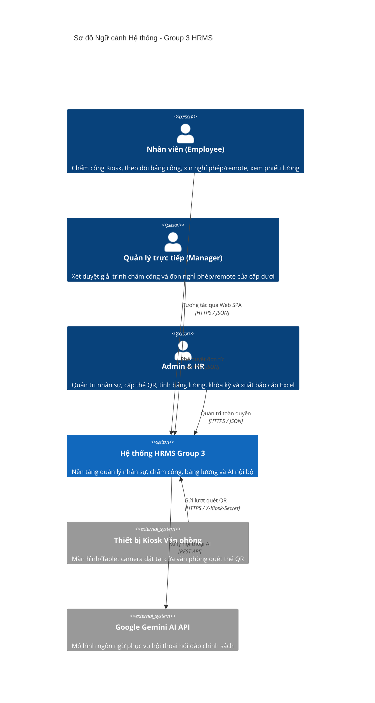
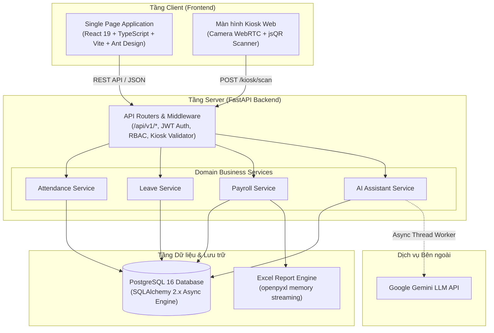
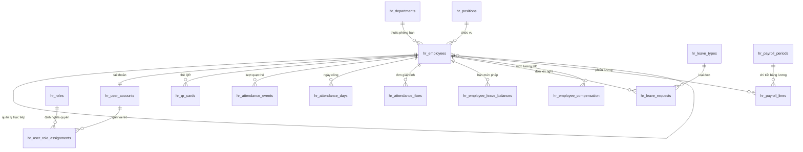
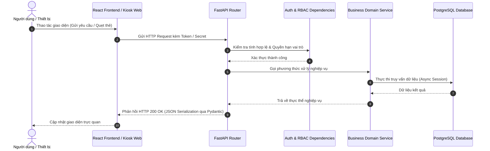

# SOFTWARE ARCHITECTURE DOCUMENT (SAD)
## HỆ THỐNG QUẢN LÝ NHÂN SỰ & CHẤM CÔNG THÔNG MINH (GROUP 3 HRMS)

Tài liệu này mô tả kiến trúc tổng thể của hệ thống **HR Management System (Group 3)**, đóng vai trò định hướng cho việc phát triển, bảo trì và tích hợp hệ thống.

---

### 1. Giới thiệu tổng quan & Phạm vi hệ thống

Hệ thống được thiết kế theo mô hình **Client - Server hiện đại** phục vụ quản trị nhân sự nội bộ cho doanh nghiệp với các khối chức năng chính:
* **Quản trị Tổ chức & Nhân sự:** Quản lý cơ cấu phòng ban, chức danh, hồ sơ nhân viên và quan hệ quản lý phân cấp trực tiếp (`manager_employee_id`).
* **Chấm công Kiosk & Thẻ QR tĩnh:** Nhận diện lượt vào/ra (`CHECK_IN`/`CHECK_OUT`) qua thiết bị Kiosk Web tại cửa văn phòng, chống quét lặp và tổng hợp ngày công tự động.
* **Xử lý Giải trình công & Lưu vết đối chiếu:** Luồng nhân viên gửi giải trình bổ sung giờ quét, Quản lý trực tiếp phê duyệt và lưu vết lịch sử phục vụ đối chiếu khiếu nại.
* **Quản lý Nghỉ phép & Làm việc từ xa (Remote):** Đơn xin nghỉ theo buổi/ngày, hạn mức phép năm và cơ chế duyệt phân cấp.
* **Tính lương & Thuế TNCN:** Tự động tính toán lương Gross/Net, bảo hiểm bắt buộc, thuế TNCN theo luật Việt Nam, khóa kỳ lương và xuất báo cáo Excel.
* **Trợ lý AI nội bộ:** Hỗ trợ hỏi đáp chính sách và tra cứu dữ liệu cá nhân theo ngữ cảnh.

---

### 2. Các nguyên tắc kiến trúc cốt lõi (Architectural Drivers)

1. **Clean Layered Architecture:** Tách bạch ranh giới giữa Tầng Trình diễn (Presentation), Tầng Định tuyến API (API Routing), Tầng Dịch vụ Nghiệp vụ (Domain Services) và Tầng Lưu trữ Dữ liệu (Persistence).
2. **Stateless Backend:** Backend FastAPI hoạt động hoàn toàn không phụ thuộc trạng thái phiên (session state) trên bộ nhớ máy chủ. Mọi yêu cầu được xác thực thông qua JWT Token độc lập.
3. **Async Non-blocking I/O:** Khai thác tối đa mô hình xử lý bất đồng bộ (`asyncio` kết hợp driver `asyncpg`) giúp tối ưu hiệu năng I/O và phục vụ nhiều kết nối đồng thời với lượng tài nguyên nhỏ.
4. **Separation of Concerns & Type Safety:** 
   * Frontend sử dụng TypeScript và Ant Design component-based.
   * Backend chuẩn hóa dữ liệu vào/ra bằng Pydantic v2 DTOs và SQLAlchemy 2.x Declarative Models.
5. **Độ tin cậy & Chống nghẽn (Fault-Tolerance):** Các thao tác tích hợp bên ngoài (LLM AI) được bao bọc bởi cơ chế timeout và xử lý đa luồng worker, đảm bảo không bao giờ làm nghẽn Event Loop chính của ứng dụng.

---

### 3. Kiến trúc C4 Model

#### 3.1. C4 - Level 1: Ngữ cảnh hệ thống (System Context)



---

#### 3.2. C4 - Level 2: Kiến trúc Container (Container Architecture)



---

### 4. Phân tầng kiến trúc (Layered Architecture)

Hệ thống phân tách mạch lạc thành 4 tầng chính:

```text
┌────────────────────────────────────────────────────────┐
│ 1. PRESENTATION LAYER (React 19 + TypeScript + Vite)   │
│    - Pages, Components, Layouts, Router & AuthContext │
└──────────────────────────┬─────────────────────────────┘
                           │ HTTP REST / JSON
┌──────────────────────────▼─────────────────────────────┐
│ 2. API ROUTING & SECURITY LAYER (FastAPI)              │
│    - Endpoints, JWT Verification, RBAC Dependencies    │
│    - Request/Response Validation (Pydantic Schemas)    │
└──────────────────────────┬─────────────────────────────┘
                           │ Service Calls
┌──────────────────────────▼─────────────────────────────┐
│ 3. DOMAIN BUSINESS SERVICES LAYER                      │
│    - AttendanceService: Chấm công, Kiosk, Giải trình   │
│    - LeaveService: Nghỉ phép, Remote, Hạn mức quota    │
│    - PayrollService: Công chuẩn, Bảo hiểm, Thuế TNCN   │
│    - AIService: RAG chính sách, tra cứu ngữ cảnh       │
└──────────────────────────┬─────────────────────────────┘
                           │ Async ORM (SQLAlchemy 2.x)
┌──────────────────────────▼─────────────────────────────┐
│ 4. DATA PERSISTENCE LAYER                              │
│    - PostgreSQL 16 (Relational DB, Indexes, Relations) │
│    - Alembic (Database Migrations Version Control)     │
└────────────────────────────────────────────────────────┘
```

#### 4.1. Tầng Trình diễn (Presentation Layer - Frontend)
* **Kiến trúc SPA:** Xây dựng với React 19 và Vite, đóng gói ứng dụng tải nhanh, tương tác mượt mà.
* **Hệ thống Design System:** Ant Design v5 cung cấp các thành phần giao diện chuẩn nghiệp vụ (Table, Tabs, Modal, Form, Tooltip, Tag, Badge).
* **Quản lý Trạng thái & Định tuyến:**
  * `AuthContext` duy trì phiên làm việc, lưu trữ token và thông tin vai trò (`roles`).
  * `ProtectedRoute` bảo vệ các tuyến đường theo phân quyền RBAC (`ADMIN`, `HR`, `MANAGER`, `EMPLOYEE`).
  * Axios Client tập trung (`api/client.ts`) với Interceptor tự động gán Bearer Token và xử lý lỗi phản hồi thống nhất.

#### 4.2. Tầng Định tuyến & Bảo mật API (API & Security Layer)
* Sử dụng FastAPI hỗ trợ chuẩn OpenAPI 3.0 (Swagger UI tự động).
* **Dependency Injection (`deps.py`):**
  * `get_current_user`: Trích xuất và giải mã JWT token từ Header `Authorization`.
  * `require_roles`: Kiểm soát quyền truy cập chi tiết tại từng endpoint.
  * `verify_kiosk_secret`: Xác thực thiết bị Kiosk qua Header bí mật riêng biệt `X-Kiosk-Secret`.
* **Data Transfer Objects (DTO):** Pydantic v2 schemas chịu trách nhiệm validate dữ liệu đầu vào và lọc bỏ các trường nhạy cảm ở đầu ra.

#### 4.3. Tầng Xử lý Nghiệp vụ Lõi (Domain Services Layer)
Toàn bộ quy tắc nghiệp vụ được cô lập trong các Service độc lập, không phụ thuộc vào giao thức HTTP:
* **AttendanceService:** Điều phối sự kiện quét thẻ, nhận diện Check-in/Check-out tự động, tổng hợp giờ làm việc trong ngày và xử lý đơn giải trình quên chấm công.
* **LeaveService:** Thẩm định đơn nghỉ phép/remote theo buổi hoặc ngày, quản lý hạn mức phép năm và kiểm soát thẩm quyền xét duyệt của Quản lý trực tiếp.
* **PayrollService:** Tổng hợp ngày công thực tế, tính toán lương Gross/Net, các khoản trích nộp bảo hiểm bắt buộc, thuế TNCN và kết xuất file Excel bảng lương.
* **AIService:** Phân tích ý định câu hỏi, nạp ngữ cảnh dữ liệu cá nhân của nhân viên và tích hợp mô hình ngôn ngữ lớn (LLM).

#### 4.4. Tầng Lưu trữ Dữ liệu (Data Persistence Layer)
* **Cơ sở dữ liệu:** PostgreSQL 16 lưu trữ dữ liệu có cấu trúc, quan hệ chặt chẽ và toàn vẹn dữ liệu ACID.
* **Async ORM:** SQLAlchemy 2.x khai thác cú pháp `Mapped` type-safe, thực thi truy vấn bất đồng bộ qua `asyncpg`.
* **Migration:** Alembic quản lý lịch sử tiến hóa lược đồ cơ sở dữ liệu có phiên bản.

---

### 5. Kiến trúc Bảo mật (Security Architecture)

1. **Bảo mật Mật khẩu:** Băm mật khẩu một chiều sử dụng thuật toán tiêu chuẩn `bcrypt` với muối ngẫu nhiên (salt rounds an toàn).
2. **Xác thực Token (JWT Authentication):**
   * Sử dụng cơ chế ký số bảo mật HMAC-SHA256 (`HS256`).
   * `access_token` có thời hạn ngắn (8 tiếng, tương ứng ca làm việc), mang thông tin định danh và phân quyền.
3. **Phân quyền vai trò (Role-Based Access Control - RBAC):**
   * Hệ thống hỗ trợ 4 vai trò: `ADMIN`, `HR`, `MANAGER`, `EMPLOYEE`.
   * Quyền hạn được kiểm tra ở cấp độ Endpoint trước khi logic nghiệp vụ được thực thi.
4. **Bảo mật thiết bị Kiosk:**
   * Màn hình Kiosk quét thẻ giao tiếp với Backend qua mã khóa bí mật `X-Kiosk-Secret`.
   * Mã thẻ QR lưu trong cơ sở dữ liệu dưới dạng hash SHA-256; token thô không được lưu trữ trực tiếp.
5. **Toàn vẹn dữ liệu (Auditability):**
   * Sự kiện quét thẻ (`hr_attendance_events`) hoạt động theo nguyên tắc Append-Only (chỉ thêm mới, không sửa/xóa).
   * Mọi thao tác phê duyệt giải trình và đơn nghỉ phép đều lưu vết rõ ràng: ID người duyệt (`reviewer_employee_id`), thời gian duyệt (`reviewed_at`) và ghi chú phản hồi (`review_note`).

---

### 6. Mô hình Dữ liệu mức cao (High-Level Data Architecture)

Lược đồ cơ sở dữ liệu được tổ chức thành các phân vùng nghiệp vụ mạch lạc:



---

### 7. Thuộc tính phi chức năng & Vận hành (NFRs)

| Tiêu chuẩn | Mục tiêu thiết kế | Giải pháp kiến trúc |
| :--- | :--- | :--- |
| **Hiệu năng (Performance)** | Phản hồi API < 100ms với tác vụ thông thường | Asyncpg connection pool, thiết lập chỉ mục Index trên các trường truy vấn thường xuyên (`work_date`, `employee_id`, `status`). |
| **Khả năng mở rộng (Scalability)** | Hỗ trợ mở rộng quy mô máy chủ | Backend được thiết kế hoàn toàn Stateless, cho phép chạy song song nhiều worker/container phía sau Load Balancer. |
| **Độ tin cậy (Reliability)** | Hoạt động ổn định, phục hồi nhanh | Database container hóa với Docker Volume bền vững, endpoint `/health` phục vụ giám sát liveness/readiness. |
| **Khả năng bảo trì (Maintainability)** | Cấu trúc module hóa cao | Áp dụng Clean Architecture, phân tách rõ ràng Models/Schemas/Services/Routers. |

---

### 8. Sơ đồ tuần tự tương tác tổng thể (Request Lifecycle)


