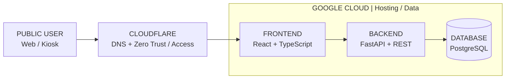
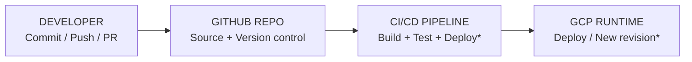

# KIẾN TRÚC HẠ TẦNG & TRIỂN KHAI CI/CD

**Phiên bản tài liệu:** 1.0 | **Ngày:** 12/10/2026 | **Phạm vi:** Kiến trúc triển khai & vận hành

## 1. Mục tiêu và phạm vi

Mô tả hai dòng chảy riêng biệt của hệ thống HRMS: (1) truy cập của người dùng qua Cloudflare tới ứng dụng và cơ sở dữ liệu trên Google Cloud; (2) cập nhật mã nguồn từ GitHub đến môi trường GCP qua CI/CD. Tài liệu dành cho báo cáo nhóm, diễn giải giải pháp, đối chiếu vận hành và đánh giá bảo mật.

**Quy ước bằng chứng:** [Đã đối chiếu repo] là thông tin đọc trực tiếp từ mã nguồn/tài liệu repository; [Theo mô tả vận hành] là kiến trúc do nhóm cung cấp; [Cần xác minh] là cấu hình nằm ngoài mã nguồn đã truy xuất hoặc chưa có bằng chứng trực tiếp.

## 2. Sơ đồ kiến trúc tổng thể

**Luồng truy cập | Runtime**

**Luồng triển khai | Delivery**

*\* Công cụ CI/CD, trigger, dịch vụ GCP và chiến lược rollback cần xác minh từ cấu hình production.*

**Hình 1.** Luồng runtime (trên) và luồng phát hành code (dưới). GitHub không phải một chặng trên tuyến request của người dùng.

## 3. Thành phần và trách nhiệm

| Thành phần | Vai trò | Trạng thái |
| --- | --- | --- |
| Public user / Kiosk | Trình duyệt nhân viên, HR, quản lý và thiết bị Kiosk. | [Theo mô tả vận hành] |
| Cloudflare DNS | Tên miền phân giải tới điểm truy cập ứng dụng; quản lý DNS record. | [Theo mô tả vận hành] |
| Cloudflare Zero Trust / Access | Lớp chính sách xác thực, cho phép hoặc chặn truy cập trước ứng dụng đối với hostname/path được bảo vệ. | [Theo mô tả vận hành] |
| Frontend | React, TypeScript, Vite; giao diện người dùng và HTTP client gửi API. | [Đã đối chiếu repo] |
| Backend API | Python FastAPI, REST `/api/v1`; JWT, phân quyền RBAC và logic nghiệp vụ. | [Đã đối chiếu repo] |
| Database | PostgreSQL, SQLAlchemy/Alembic; lưu dữ liệu nhân sự, chấm công, đơn và kỳ lương. | [Đã đối chiếu repo] |
| GitHub | Lưu trữ mã nguồn, cộng tác, lịch sử thay đổi, pull request. | [Đã đối chiếu repo] |
| CI/CD → GCP | Thực thi build/test và tự động triển khai khi code thay đổi theo trigger được cấu hình. | [Theo mô tả vận hành; công cụ cụ thể cần xác minh] |

## 4. Luồng truy cập người dùng (runtime)

1. **B1.** Người dùng mở `https://hrms-group3.vuta.it.com/` trên trình duyệt (hostname theo thông tin nhóm đã cung cấp).
2. **B2.** Trình duyệt sử dụng DNS để xác định đường đến dịch vụ Cloudflare; yêu cầu HTTPS đi tới biên Cloudflare.
3. **B3.** Nếu hostname/path đặt sau Cloudflare Access, người dùng đáp ứng chính sách đăng nhập/ủy quyền trước khi request được chuyển đến origin. Đây là xác thực ở lớp biên, không tự động thay thế JWT/RBAC của HRMS.
4. **B4.** Frontend được tải về trình duyệt; frontend gọi `/api/v1` để lấy dữ liệu hoặc thực hiện thao tác.
5. **B5.** Backend xác minh token và quyền nghiệp vụ; truy vấn/ghi PostgreSQL và trả JSON về trình duyệt qua tuyến mạng đã cấu hình.
6. **B6.** Với Kiosk, request chấm công sử dụng header `X-Kiosk-Secret` theo thiết kế ứng dụng; cần cho phép thiết bị hoạt động phù hợp chính sách Cloudflare Access.

## 5. Luồng CI/CD từ GitHub đến GCP

1. Developer sửa code frontend/backend, commit và push lên GitHub; có thể thông qua pull request và review.
2. Trigger tự động (push/merge lên nhánh phát hành, hoặc trigger khác) kích hoạt pipeline theo cấu hình thực tế.
3. CI lấy source, cài dependencies, chạy kiểm tra cần thiết: `npm build`, `pytest`, lint/security scan nếu được thiết lập.
4. CD đóng gói build artifact/container image, xác thực tới Google Cloud và triển khai phiên bản mới.
5. Sau deploy: chạy health check/smoke test, theo dõi log; nếu phiên bản lỗi phải rollback về bản ổn định trước đó.

**Cập nhật trạng thái trong tài liệu gốc:**

- Google Cloud: đang dùng **Cloud Run**.
- PostgreSQL: **Cloud SQL for PostgreSQL**.
- Cloudflare: **DNS proxied**, Zero Trust Access policy bảo vệ truy cập vào ứng dụng.
- CI/CD: **Google Cloud Build → Cloud Run**.

## 6. Phân tách bảo mật theo lớp

| Lớp | Chức năng | Kiểm soát cần rà soát |
| --- | --- | --- |
| Cloudflare DNS/Edge | DNS, HTTPS/TLS tại biên, chính sách Access tùy cấu hình; có thể bổ sung WAF/rate limit. | Kiểm tra hostname được bảo vệ, bypass path, session TTL, log Access. |
| Cloudflare Access | Kiểm soát ai được đi tới ứng dụng/đường dẫn. | Kiểm tra IdP, policy Allow/Deny, service token/Kiosk nếu cần. |
| HRMS application | JWT xác thực phiên và RBAC theo ADMIN/HR/MANAGER/EMPLOYEE. | Không tin header phía client; luôn kiểm tra phân quyền tại backend. |
| Backend → Database | Tài khoản DB riêng, network isolation, giới hạn quyền. | DB không public; backups; rotation secrets; TLS nếu phù hợp. |
| GitHub → GCP | Quyền deploy tối thiểu; bảo vệ nhánh và secrets. | Ưu tiên Workload Identity Federation/OIDC; không commit credential JSON. |

## 7. Kết luận dành cho báo cáo

Kiến trúc Group 3 HRMS tách biệt mặt phẳng phục vụ người dùng và mặt phẳng phát hành mã nguồn. Cloudflare là lớp truy cập và bảo vệ ở biên; Google Cloud vận hành frontend/backend/database; GitHub quản lý mã nguồn và kích hoạt cập nhật tự động qua CI/CD. Bên trong hệ thống, FastAPI tiếp tục áp dụng JWT và RBAC để bảo vệ dữ liệu nhân sự.

---

*Nguồn: `Group3_HRMS_Cloudflare_GCP_GitHub_CICD_Architecture(3).docx` (tài liệu đính kèm của nhóm), chuyển sang Markdown. Sơ đồ gốc được dựng lại bằng Mermaid, giữ nguyên nội dung logic. Phần `Build + Test` trong sơ đồ là quy trình mô tả, không khẳng định tất cả bước CI đã được kiểm chứng trên production.*